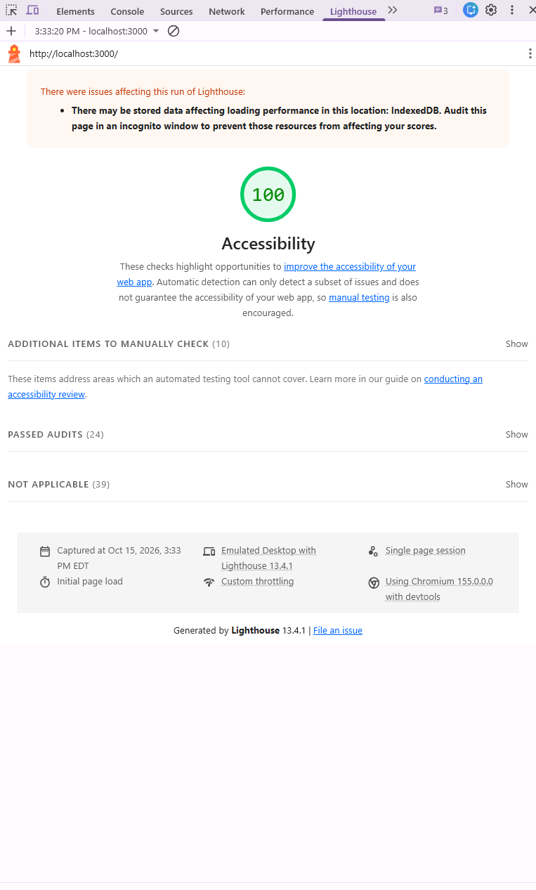
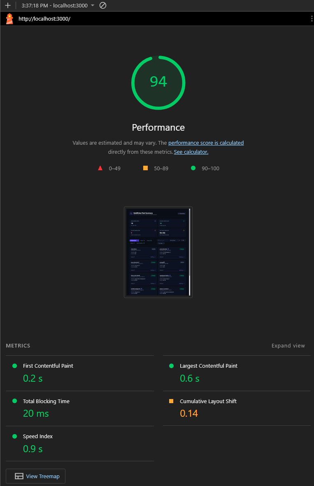
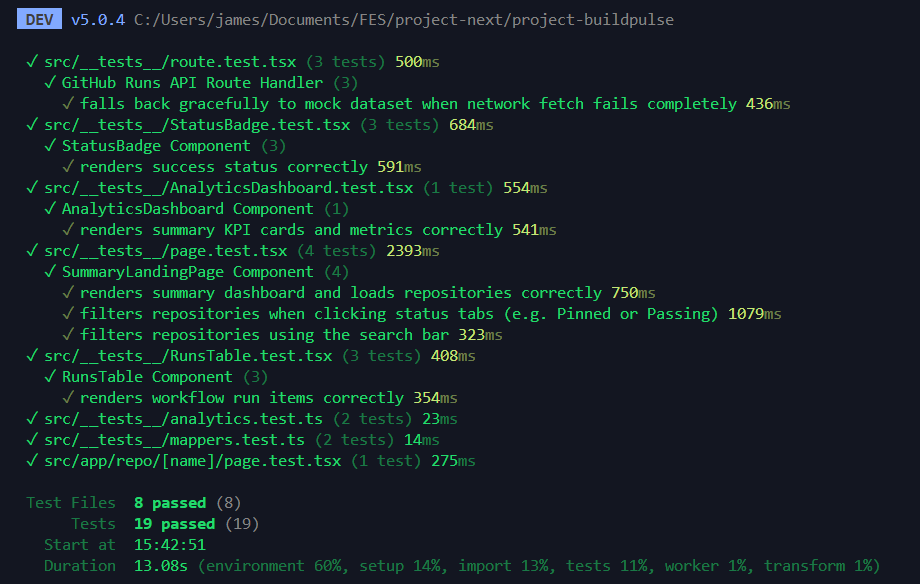

[](https://github.com/jamespa001/project-buildpulse/actions/workflows/ci.yml)

# 🚀 BuildPulse

**BuildPulse** is a real-time health and CI monitoring dashboard engineered for developers and engineering teams to oversee workflow statuses, build durations, and pipeline reliability across multiple monitored GitHub repositories.

---

## ✨ Key Features

- **Fleet Summary Dashboard**: High-level KPI banner tracking total monitored repositories, global pass rates, passing/failing workflow counts, and fleet-average build speeds.
- **Advanced Filtering & Search**: Instant client-side filtering by status (_Passing_, _Failing_, _Needs Attention_, _Pinned_) and lightning-fast search by repository name or workflow.
- **Persistent & Optimistic Pinning**: Pin critical repositories to the top of your fleet overview for immediate monitoring access.
- **Deep-Dive Telemetry View**: Inspect detailed execution history, success/failure trends, and analytics per repository (`/repo/[name]`).
- **WCAG Compliant Accessibility**: Fully optimized semantic landmarks (`<main>`, `<header>`, `<section>`, `<h1-h3>`), ARIA attributes (`aria-selected`, `aria-label`), and robust keyboard navigation achieving a **100 Lighthouse Accessibility Score**.
- **Robust Automated Testing**: 100% passing test suite built with **Vitest** and **React Testing Library**.

---

## 📊 Quality, Performance & Test Results

|                     Lighthouse Accessibility Score (100%)                      |                     Lighthouse Performance Score (94%)                     |     Vitest & Testing Library Suite (100% Passing)      |
| :----------------------------------------------------------------------------: | :------------------------------------------------------------------------: | :----------------------------------------------------: |
|  |  |  |

---

## 🛠️ Tech Stack

- **Framework**: Next.js (App Router, React Server & Client Components)
- **Styling**: Tailwind CSS
- **Icons**: Lucide React
- **Testing**: Vitest, React Testing Library, jsdom
- **Deployment**: Vercel / Google Cloud Run (Dockerized)

---

## 🚀 Getting Started

### Prerequisites

- Node.js 18+ installed on your machine.

### Installation & Run

1. Clone the repository:
   ```bash
   git clone [https://github.com/jamespa001/project-buildpulse.git](https://github.com/jamespa001/project-buildpulse.git)
   cd project-buildpulse
   ```
